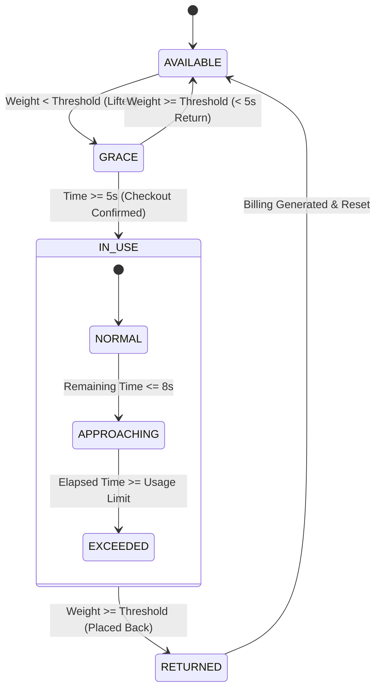

# Musical Instrument Smart Shelf Simulator

An ESP32-based embedded IoT smart shelf simulation that monitors musical instrument availability, tracks usage duration, enforces time limits with visual and audible alerts, calculates rental billing in real time, and persists configuration to Non-Volatile Storage (NVS).

Designed for music rental shops, instrument libraries, rehearsal studios, and equipment loan stations. Built with the **Arduino framework on ESP32**, managed using **PlatformIO**, and configured for direct simulation with **Wokwi**.

---

## Overview

In music schools and rental studios, tracking musical instruments manually can lead to unrecorded borrowing, missed return deadlines, and billing discrepancies.

The **Musical Instrument Smart Shelf Simulator** automates shelf inventory tracking for four independent instrument stations:
1. **Guitar** (Slot 1)
2. **Violin** (Slot 2)
3. **Keyboard** (Slot 3)
4. **Flute** (Slot 4)

Each shelf position features a load cell sensor that detects weight changes. When an instrument is lifted:
- A configurable **5-second grace period** prevents accidental checkouts if someone briefly adjusts an instrument.
- Once the grace period expires, an active checkout session begins with timestamping from an on-board **Real-Time Clock (RTC)**.
- Status LEDs and an I2C character LCD display real-time usage duration.
- As the usage limit approaches, visual indicators change blink rates. If the limit is exceeded, rapid flashing and a **piezo buzzer alarm** activate.
- Upon returning the instrument to the shelf, the session closes, billable time is rounded up to the nearest minute, rental fees are calculated in Indian Rupees (Paise/Rs.), and a detailed billing receipt is emitted to the serial terminal.
- An interactive **4-button control panel** allows administrators to view channels, switch display modes, and adjust presence thresholds, usage limits, and rental rates in real time, saving them directly to ESP32 flash memory.

---

## Features

- **Multi-Channel Weight Sensing**: Four independent HX711 ADC interfaces with 5 kg load cell inputs, smoothed by a 5-sample moving average buffer.
- **Grace Period Protection**: 5,000 ms grace window allows users to pick up or inspect an instrument briefly without starting a paid session.
- **Multi-Phase Usage State Machine**:
  - `AVAILABLE`: Instrument is securely placed on the shelf.
  - `GRACE`: Instrument lifted; countdown running to confirm active checkout.
  - `IN_USE` (`NORMAL`): Checkout confirmed; elapsed time tracked.
  - `IN_USE` (`APPROACHING`): Warning stage when within 8 seconds of the usage limit.
  - `IN_USE` (`EXCEEDED`): Overtime stage triggering audible alarm.
  - `RETURNED`: Instrument replaced; calculates duration, computes cost, and transitions back to `AVAILABLE`.
- **Integrated Rental Billing Engine**:
  - Custom hourly rates per instrument (calculated in Paise for integer precision).
  - Ceiling-based minute billing: `(usedSeconds + 59) / 60`.
  - Automated session invoice output over Serial with timestamps and formatted amounts (`Rs.XX.YY`).
- **Real-Time Clock (RTC) Support**:
  - Compatible with DS1307 (default in Wokwi schematic) and DS3231 I2C RTC modules.
  - Generates ISO-style timestamps (`YYYY-MM-DD hh:mm:ss`) for checkout and return events.
  - Graceful fallback: If RTC is unavailable, sessions continue with `"no-rtc"` markers; if RTC power was lost, time is set from compile time.
- **Tiered Audio-Visual Notifications**:
  - **LED Off**: Slot is available.
  - **LED Slow Blink (500 ms)**: Slot in grace period.
  - **LED Solid ON**: Normal active checkout session.
  - **LED Medium Blink (250 ms)**: Time limit approaching (<= 8 seconds remaining).
  - **LED Fast Strobe (100 ms)**: Time limit exceeded.
  - **Buzzer Pulsing (300 ms)**: Active buzzer beeps continuously while any instrument exceeds its limit.
- **Flicker-Free 1602 LCD Display**:
  - Differential rendering: Only updates LCD memory when screen lines change, eliminating display flicker.
  - Auto-Cycle Mode (`AUT`): Cycles through all 4 instrument channels every 2 seconds.
  - Manual Mode (`MAN`): Locks on a single channel for dedicated inspection.
- **On-Device Configuration Menu (NVS Persistent)**:
  - 4 physical pushbuttons (`SET`, `NEXT`, `UP`, `DOWN`) with software debounce (30 ms).
  - Long press `SET` (>= 800 ms) to enter/exit configuration mode.
  - In-place calibration of **Presence Threshold**, **Usage Limit (seconds)**, and **Hourly Rate (Paise/Rs.)**.
  - Hold-to-repeat acceleration on `UP`/`DOWN` buttons for fast parameter changes.
  - Saved parameters persist across reboots via ESP32 `Preferences` (NVS) under the `shelfcfg` namespace with diagnostic readback verification.

---

## Project Structure

```text
MusicalInstrumentSim/
├── .gitignore               # Git ignore rules (.pio build cache, VS Code caches)
├── .vscode/                 # VS Code PlatformIO extension configurations
│   ├── c_cpp_properties.json# C/C++ Intellisense configuration
│   ├── extensions.json      # Recommended extension (PlatformIO IDE)
│   └── launch.json          # Debugging launcher profiles
├── diagram.json             # Wokwi simulation circuit layout and wiring
├── include/
│   └── README               # PlatformIO include folder placeholder
├── lib/
│   └── README               # PlatformIO custom library folder placeholder
├── platformio.ini           # PlatformIO project configuration & dependency manifest
├── src/
│   └── main.cpp             # Complete firmware implementation
├── test/
│   └── README               # PlatformIO test folder placeholder
└── wokwi.toml               # Wokwi simulator entry point and binary target configuration
```

---

## Technologies Used

- **Hardware Platform**: Espressif ESP32 (`esp32dev` / ESP32-WROOM-32 / DevKit C v4)
- **Framework**: Arduino for ESP32 (via PlatformIO `espressif32` platform)
- **Build System**: [PlatformIO Core](https://platformio.org/)
- **Simulation**: [Wokwi Embedded Systems Simulator](https://wokwi.com/)
- **Programming Language**: C++ (C++11 / C++14)
- **External Libraries**:
  - `bogde/HX711` (v0.7.5): 24-bit ADC driver for load cells
  - `marcoschwartz/LiquidCrystal_I2C` (v1.1.4): HD44780 LCD driver via PCF8574 I2C expander
  - `adafruit/RTClib` (v2.1.1): Driver for DS1307 / DS3231 I2C real-time clocks
  - `Preferences`: Built-in ESP32 Non-Volatile Storage (NVS) key-value store
  - `Wire`: ESP32 two-wire I2C interface library

---

## Hardware Architecture & Pinout

### ESP32 Pin Assignment Table

| Peripheral | Component | ESP32 GPIO | Description / Mode |
| :--- | :--- | :--- | :--- |
| **Load Cell 1 (Guitar)** | HX711 #1 | `GPIO 32` (DT), `GPIO 14` (SCK) | Digital I/O (Input / Output) |
| **Load Cell 2 (Violin)** | HX711 #2 | `GPIO 33` (DT), `GPIO 15` (SCK) | Digital I/O (Input / Output) |
| **Load Cell 3 (Keyboard)** | HX711 #3 | `GPIO 25` (DT), `GPIO 12` (SCK) | Digital I/O (Input / Output) |
| **Load Cell 4 (Flute)** | HX711 #4 | `GPIO 26` (DT), `GPIO 5` (SCK) | Digital I/O (Input / Output) |
| **Status LED 1 (Guitar)** | Red LED 1 | `GPIO 13` | Digital Output (via 220Ω resistor) |
| **Status LED 2 (Violin)** | Red LED 2 | `GPIO 16` | Digital Output (via 220Ω resistor) |
| **Status LED 3 (Keyboard)** | Red LED 3 | `GPIO 17` | Digital Output (via 220Ω resistor) |
| **Status LED 4 (Flute)** | Red LED 4 | `GPIO 18` | Digital Output (via 220Ω resistor) |
| **Buzzer** | Active/Passive Buzzer | `GPIO 27` | Digital Output |
| **I2C Bus - Data** | LCD1602 & DS1307 | `GPIO 21` | I2C SDA (0x27 LCD, 0x68 RTC) |
| **I2C Bus - Clock** | LCD1602 & DS1307 | `GPIO 22` | I2C SCL |
| **Button 1 (SET)** | Tactile Pushbutton | `GPIO 4` | Digital Input (`INPUT_PULLUP`) |
| **Button 2 (NEXT)** | Tactile Pushbutton | `GPIO 19` | Digital Input (`INPUT_PULLUP`) |
| **Button 3 (UP)** | Tactile Pushbutton | `GPIO 23` | Digital Input (`INPUT_PULLUP`) |
| **Button 4 (DOWN)** | Tactile Pushbutton | `GPIO 34` | Digital Input (`INPUT`) with external 10kΩ pull-up |

> [!NOTE]
> `GPIO 34` on the ESP32 is an input-only pin without internal pull-up resistor circuitry. As wired in `diagram.json`, it utilizes an external 10 kΩ pull-up resistor connected to 3.3V.

```
                         +-----------------------------+
                         |      ESP32 DevKit C v4      |
                         +-----------------------------+
                          |   |   |   |   |   |   |   |
      +-------------------+   |   |   |   |   |   |   +-------------------+
      |                       |   |   |   |   |   |                       |
+-------------+               |   |   |   |   |   |               +---------------+
| HX711 (x4)  |---------------+   |   |   |   |   +---------------| 1602 I2C LCD  |
| Load Cells  | (GPIO 32,33,25,26 |   |   |   |   | (SDA=21       | Address: 0x27 |
+-------------+  SCK: 14,15,12,5) |   |   |   |   |  SCL=22)      +---------------+
                                  |   |   |   |   |                       |
                          +-------+   |   |   +---+-------+               |
                          |           |   |               |               |
                    +-----------+     |   |         +-----------+   +-----------+
                    | LEDs (x4) |     |   |         |  Buzzer   |   |  DS1307   |
                    | (GPIO     |     |   |         | (GPIO 27) |   |  RTC I2C  |
                    | 13,16,    |     |   |         +-----------+   +-----------+
                    | 17,18)    |     |   |
                    +-----------+     |   +-----------------------+
                                      |                           |
                               +---------------+         +-----------------+
                               | Buttons (x3)  |         | Button 4 (DOWN) |
                               | SET: GPIO 4   |         | GPIO 34         |
                               | NEXT: GPIO 19 |         | (External 10k   |
                               | UP: GPIO 23   |         |  Pull-Up)       |
                               +---------------+         +-----------------+
```

---

## How It Works

### Finite State Machine (FSM)

Each of the four channels runs an independent state machine on every `loop()` cycle:



1. **Boot Initialization**: At startup, `setup()` loads preferences from NVS, initializes I2C, checks RTC state, powers up HX711 scales, reads initial shelf weights over 500 ms, and assigns initial states (`AVAILABLE` if weight exceeds threshold, else `GRACE`).
2. **Weighing & Smoothing**: In each loop cycle, `pollChannel(i)` checks non-blocking readiness (`scale.is_ready()`). New readings are stored in a circular buffer (`sampleBuffer[4][5]`) to calculate a rolling average.
3. **Grace Handling**: When weight drops below threshold, the slot enters `GRACE`. If replaced within 5 seconds, the checkout is cancelled without penalty.
4. **Active Rental Session**: If still lifted after 5 seconds, the state changes to `IN_USE`. A start timestamp is captured from the RTC.
5. **Phase Warnings**:
   - `NORMAL`: Elapsed time is within safe boundaries. LED is solid.
   - `APPROACHING`: Instrument has less than 8 seconds left before hitting its limit. LED blinks at 250 ms.
   - `EXCEEDED`: Instrument is overdue. LED strobes at 100 ms, and the piezo buzzer begins pulsing at 300 ms intervals.
6. **Return & Billing Computation**:
   - When returned, billable minutes are calculated as `(usedSeconds + 59) / 60`.
   - Cost in paise: `(billableMinutes * ratePerHourPaise) / 60`.
   - A billing record is output to Serial, and the channel returns to `AVAILABLE`.

---

## Default Slot Configuration

The project ships with the following default values (stored in code and loaded into NVS if uninitialized):

| Slot | Instrument | DOUT / SCK | LED Pin | Presence Threshold | Usage Limit | Warning Window | Hourly Rate |
| :---: | :--- | :---: | :---: | :---: | :---: | :---: | :---: |
| **0** | **Guitar** | 32 / 14 | 13 | 300 units | 20 seconds | 8 seconds | Rs. 100.00 / hr (10,000 paise) |
| **1** | **Violin** | 33 / 15 | 16 | 300 units | 20 seconds | 8 seconds | Rs. 150.00 / hr (15,000 paise) |
| **2** | **Keyboard**| 25 / 12 | 17 | 300 units | 20 seconds | 8 seconds | Rs. 120.00 / hr (12,000 paise) |
| **3** | **Flute**  | 26 / 5  | 18 | 300 units | 20 seconds | 8 seconds | Rs. 80.00 / hr (8,000 paise) |

---

## Configuration & Button Controls

The control panel uses four physical pushbuttons:

| Button | Name | Normal Mode Action | Configuration Mode Action |
| :---: | :---: | :--- | :--- |
| **BTN 1** | **SET** | Short press: Toggle LCD Auto-cycle (`AUT` / `MAN`).<br>Long press (>= 800 ms): Enter Configuration Mode. | Short press: Save changes to NVS flash, verify readback, and exit Config Mode. |
| **BTN 2** | **NEXT**| Switch view to the next instrument slot (disables auto-cycle). | Cycle to next configuration field (`Thresh` -> `Limit` -> `Rate`). |
| **BTN 3** | **UP** | *(None)* | Increment current field value (supports hold-to-repeat). |
| **BTN 4** | **DOWN**| *(None)* | Decrement current field value (supports hold-to-repeat). |

### Editable Fields and Increments

1. **`Thresh` (Presence Threshold)**:
   - Adjusts minimum weight ADC value for shelf presence.
   - Step: **±50 units** (Range: `0` to `4,000`).
2. **`Limit` (Usage Time Limit)**:
   - Adjusts maximum allowed loan duration before alarm sounds.
   - Step: **±5 seconds** (Range: `5s` to `600s`).
3. **`Rate` (Hourly Rental Rate)**:
   - Adjusts hourly rental fee in Paise.
   - Step: **±Rs. 5.00** / 500 paise (Range: `Rs. 0.00` to `Rs. 1,000.00`).

---

## Requirements

### Development Environment

- [Visual Studio Code](https://code.visualstudio.com/)
- [PlatformIO IDE Extension](https://marketplace.visualstudio.com/items?itemName=platformio.platformio-ide) for VS Code
- [Wokwi Simulator Extension](https://marketplace.visualstudio.com/items?itemName=Wokwi.wokwi-vscode) for VS Code *(for virtual execution)*

### Physical Hardware (If Building Physically)

- 1x ESP32 DevKit C v4 (or equivalent 30/38-pin ESP32-WROOM development board)
- 4x HX711 Load Cell Amplifier modules & 5 kg strain gauge load cells
- 1x 1602 LCD Display with PCF8574 I2C adapter (Default address: `0x27`)
- 1x DS1307 or DS3231 I2C Real-Time Clock module with backup battery
- 4x Red LEDs & 4x 220 Ω current limiting resistors
- 1x 5V / 3.3V Buzzer
- 4x Tactile momentary pushbuttons
- 1x 10 kΩ pull-up resistor (for GPIO 34 button)
- Breadboards, 5V power supply, and jumper wires

---

## Installation & Setup

### 1. Open Project in VS Code

Clone or open the project folder in VS Code:

```bash
cd MusicalInstrumentSim
code .
```

PlatformIO will automatically detect `platformio.ini` and download required platform packages and libraries.

### 2. Compile Firmware

Build the project using the PlatformIO CLI or the VS Code PlatformIO Status Bar checkmark icon:

```bash
pio run
```

This compiles `src/main.cpp` and outputs the binary artifacts to:
- `.pio/build/esp32dev/firmware.bin`
- `.pio/build/esp32dev/firmware.elf`

### 3. Run in Wokwi Simulation

This repository includes pre-configured simulation definitions (`wokwi.toml` and `diagram.json`).

1. Ensure the Wokwi VS Code extension is installed and activated with your Wokwi license/token.
2. Build the firmware (`pio run`) so `.pio/build/esp32dev/firmware.bin` exists.
3. Open `diagram.json` in VS Code.
4. Press `F1` and select **Wokwi: Start Simulator**, or click the **Play** button in the diagram editor tab.
5. Open the built-in Serial Monitor in Wokwi to watch live diagnostic messages at 115200 baud.

### 4. Upload to Physical ESP32 Hardware

Connect your ESP32 board via USB, then run:

```bash
# Upload compiled firmware
pio run -t upload

# Open serial monitor
pio run -t monitor
```

---

## Usage Example & Workflow

### 1. Boot-Up Sequence
When the system starts up:
- Loads persistent settings from NVS (`shelfcfg`).
- Initializes I2C LCD and DS1307 RTC.
- Calibrates initial load cell values.
- LCD displays:
  ```text
  Guitar   1/4 AUT
  Available       
  ```

### 2. Instrument Lifted (Grace Period)
- Lift the Guitar load cell (reduce weight below 300).
- The red LED for Guitar begins blinking slowly (500 ms).
- LCD updates:
  ```text
  Guitar   1/4 AUT
  Grace...        
  ```

### 3. Active Rental Checkout
- Keep the Guitar lifted past 5 seconds.
- State changes to `IN_USE`. The red LED switches to solid ON.
- LCD displays active seconds:
  ```text
  Guitar   1/4 AUT
  In use        7s
  ```

### 4. Approaching Limit & Exceeded Limit Alerts
- When elapsed time reaches 12 seconds (`20s limit - 8s warning`):
  - Phase changes to `APPROACHING`.
  - LED blinks at 250 ms.
  - LCD displays: `Almost limit! 12s`.
- When elapsed time reaches 20 seconds:
  - Phase changes to `EXCEEDED`.
  - LED flashes rapidly at 100 ms.
  - Buzzer pulses at 300 ms.
  - LCD displays: `LIMIT HIT!   20s`.

### 5. Returning Instrument & Invoice Generation
- Return the Guitar to the shelf (increase weight above 300).
- Buzzer stops immediately. LED turns off.
- Terminal outputs the completed session receipt:
  ```text
  Guitar: IN_USE -> RETURNED
  [session] Guitar | removed 2026-10-03 10:15:00 | billing from 2026-10-03 10:15:05 | returned 2026-10-03 10:15:27 | billable 22s (1 min billed) | rate Rs.100.00/hr | cost Rs.1.66
  Guitar: RETURNED -> AVAILABLE
  ```

### 6. Changing Settings in Configuration Mode
1. While viewing Guitar on the LCD, press and hold `BTN_SET` for 0.8 seconds.
2. LCD enters configuration mode:
   ```text
   Cfg:Thresh Guitar
   300             
   ```
3. Press `BTN_UP` or `BTN_DOWN` to adjust threshold in increments of 50.
4. Press `BTN_NEXT` to switch to `Limit`:
   ```text
   Cfg:Limit  Guitar
   20s             
   ```
5. Press `BTN_UP` to increase the limit to `30s`.
6. Press `BTN_NEXT` to switch to `Rate`:
   ```text
   Cfg:Rate   Guitar
   Rs.100.00    /hr
   ```
7. Press `BTN_SET` (short press) to save and exit.
8. Terminal confirms flash write and verifies readback:
   ```text
   [prefs] saved Guitar
   [prefs] readback (same session) Guitar: threshold=350 limit=30s rate=Rs.100.00
   [config] exited, Guitar threshold=350 limit=30s rate=Rs.100.00
   ```

---

## Configuration Settings Reference

Settings are stored in ESP32 Non-Volatile Storage (NVS) using the `Preferences` API:

- **Namespace**: `"shelfcfg"`
- **Keys per slot index `i` (0 to 3)**:
  - `t0` - `t3` (`long`): Presence detection threshold (raw ADC reading).
  - `l0` - `l3` (`long`): Usage duration limit in seconds.
  - `r0` - `r3` (`long`): Hourly billing rate in Paise (1 Rupee = 100 Paise).

---

## Testing & Diagnostics

### Built-in Self-Diagnostics
- **NVS Readback Verification**: The `verifyReadback(int slot)` function performs an immediate readback check on flash memory following every `saveConfig()` call to verify that settings are written to non-volatile memory correctly.
- **RTC Power Status**: Verifies battery-backed state during `setup()` and automatically adjusts to firmware compile time if power was lost.
- **Diagnostic Profiler**: A configurable profiler hook (`PROFILER_ENABLED = false` in `src/main.cpp`) can be toggled to count and print `loop()` execution frequencies every 2 seconds over Serial.

### Unit Testing
The project includes the standard PlatformIO `test/` structure for PlatformIO Unit Test Runner. Automated unit test suites are currently not populated in this repository.

---

## Limitations & Known Constraints

- **Single Core Execution**: The firmware executes within standard Arduino `setup()` and `loop()` routines without FreeRTOS task pinning.
- **Sequential ADC Polling**: The 4 HX711 ADCs are polled consecutively within `loop()`. While `scale.is_ready()` prevents blocking if a channel is busy, scale conversion rate limits apply to sample freshness.
- **RTC Compile Time Sync**: When an RTC loses power, it falls back to the compile timestamp (`DateTime(F(__DATE__), F(__TIME__))`).
- **Input-Only GPIO 34**: GPIO 34 lacks internal pull-ups on the ESP32 chip; proper operation of `BTN_DOWN` requires an external pull-up resistor.
- **Virtual NVS in Wokwi**: Virtual NVS persistence in browser-based Wokwi sessions depends on the browser storage container; in-memory readbacks are validated via `verifyReadback()`.

---

## Future Improvements

*(Proposed enhancements not currently present in the codebase)*
- FreeRTOS dual-core task distribution (Core 0 dedicated to HX711 sampling; Core 1 for LCD and UI).
- Wi-Fi and MQTT / HTTP REST telemetry integration for cloud rental dashboard reporting.
- Tare calibration wizard in the on-device menu to zero out shelf weight automatically.
- Multi-color WS2812B NeoPixel indicators replacing single-color red LEDs for visual status cues.
- SD card logging for offline rental session auditing and CSV export.
